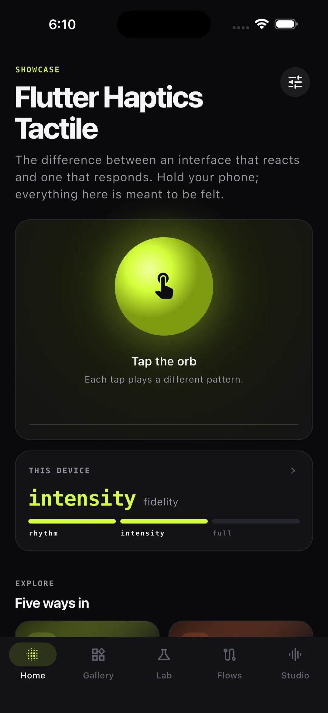
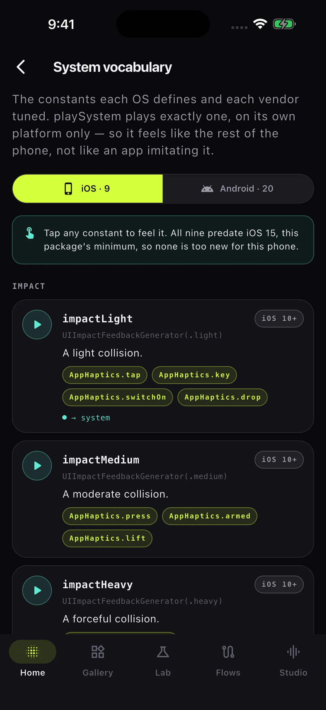
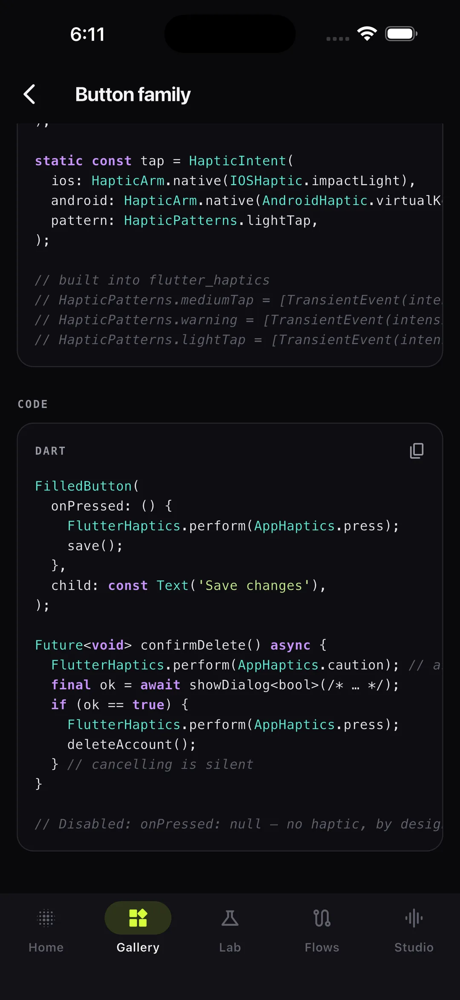
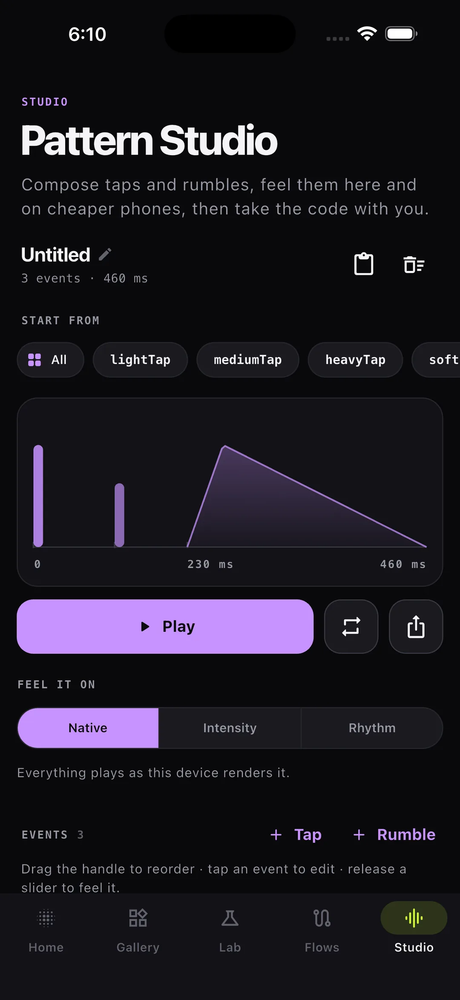
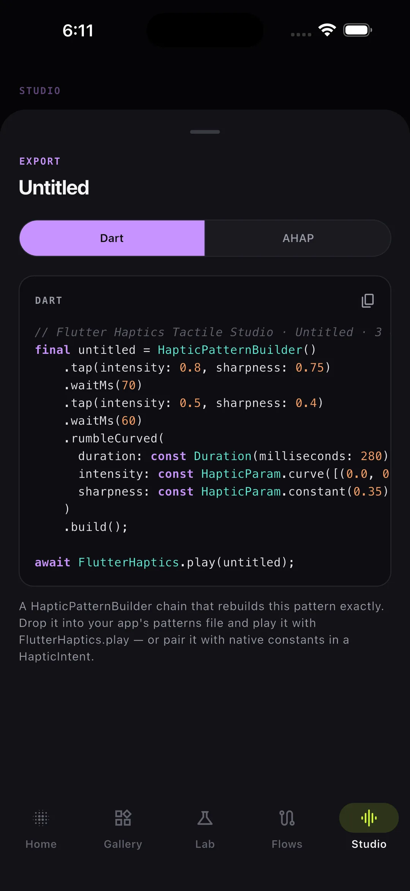

# Flutter Haptics Tactile — a flutter_haptics showcase

Flutter Haptics Tactile is a client-style app that shows what
[`flutter_haptics`](https://github.com/maherelamary/flutter_haptics) feels like
inside real UI. Every haptic comes with the reasoning behind it and the code a
client app would copy.

<p align="center">
  <a href="doc/screenshots/home.webp"></a>
  <a href="doc/screenshots/system.webp"></a>
  <a href="doc/screenshots/gallery.webp"></a>
  <a href="doc/screenshots/studio.webp"></a>
  <a href="doc/screenshots/export.webp"></a>
</p>

| Pillar | What's inside |
|---|---|
| **Gallery** | 26 everyday components, each with a "why it feels this way" note, a haptic map and a snippet. Covers buttons, switches, checkboxes, segmented controls, chips, star rating, a detent slider, a wheel picker, a stepper, a chapter scrubber, pull-to-refresh, swipe actions, a long-press menu, reordering, snap sheets, a carousel, a PIN pad, form validation, a character limit, notifications, undo, progress milestones and an async save done the Riverpod way. |
| **Lab** | 9 immersive experiments: slide-to-confirm, hold-to-confirm, a safe-cracking dial, a texture pad, bouncing balls, a dice roll, a breathing coach, a metronome and Morse code. |
| **Flows** | Checkout, onboarding and chat as end-to-end journeys. Each one ends with a **haptic recap**: every haptic fired, on a timeline, plus a budget verdict. |
| **System** | Every constant iOS (9) and Android (20) define, playable one by one through `playSystem`, with its OS version, its meaning, the `AppHaptics` meanings that use it, and the reason when it can't play here. |
| **Studio** | Compose a pattern from taps and rumbles with curves. Feel it on every fidelity tier, export it as Dart or AHAP, and import AHAP from the clipboard. |

Two extras make it work as a demo:

- **Haptic Island.** A pill at the top of the screen shows every haptic as it
  plays: whether the OS played its own constant (`SYSTEM`), a waveform played
  (`PATTERN`), or an intent fell back (`RECOVERED`). Haptics then show up in
  screen recordings and on simulators.
- **Simulate a cheaper phone** (Settings). Every pattern is degraded to the
  `intensity` or `rhythm` tier before it reaches the actuator, so a flagship can
  feel what a budget handset with a rotary motor feels.

## Run it

```bash
git clone https://github.com/maherelamary/flutter_haptics_showcase.git
cd flutter_haptics_showcase
flutter pub get
flutter run            # on a real device: simulators don't play haptics
flutter test
```

The app takes [`flutter_haptics`](https://github.com/maherelamary/flutter_haptics)
from its git repository, pinned to the `v1.0.0` tag. To try changes to the
package itself, clone it next to this project and add

```yaml
dependency_overrides:
  flutter_haptics:
    path: ../flutter_haptics
```

to `pubspec.yaml`. Dart changes are felt on the next hot restart; after
switching the dependency's source, run `flutter clean` once so Android does
not compile the old copy of the plugin alongside the new one.

## How it's wired

Riverpod 3, go_router, a feature-first `lib/src/{config,core,features}`
layout and strict lints.

```
lib/src/core/haptics/
  app_haptics.dart         # every meaning → HapticIntent + HapticArm (the only platform-aware file)
  app_patterns.dart        # the app's own waveforms and brand moments
  haptics_providers.dart   # settings → FlutterHaptics.enabled, support, log
  haptic_pacer.dart        # rate limit for intents, and for handles sharing one budget
  haptic_tracer.dart       # showcase-only: wraps the platform for the Island
  fidelity_simulator.dart  # showcase-only: degrade patterns to a cheaper tier
  pattern_math.dart        # showcase-only: read values back out of patterns
  haptic_registry.dart     # showcase-only: snippet names → live intents and patterns
  haptic_source.dart       # showcase-only: write those values back out as Dart
```

A client app needs only the first four. Repeated patterns use
`FlutterHaptics.register`, which returns a handle synchronously and paces
itself to the device. Call sites stay platform-blind:

```dart
onPressed: () {
  FlutterHaptics.perform(AppHaptics.press);
  submit();
},
```

For the full guidance (when to use haptics, when to stay silent, recipes per
component, and testing), see the `flutter-haptics` and `haptics-audit` skills in
this app's `.claude/skills/`. Their README explains how to make them available
in every client app.
